# CalenDR — Screenshots

Visual walkthrough of CalenDR, a scheduling
assistant for vaccinations & cancer screenings (Spring Boot + Thymeleaf).

> Dashboard pages are shown with representative sample data.

## Marketing & Info

### Home
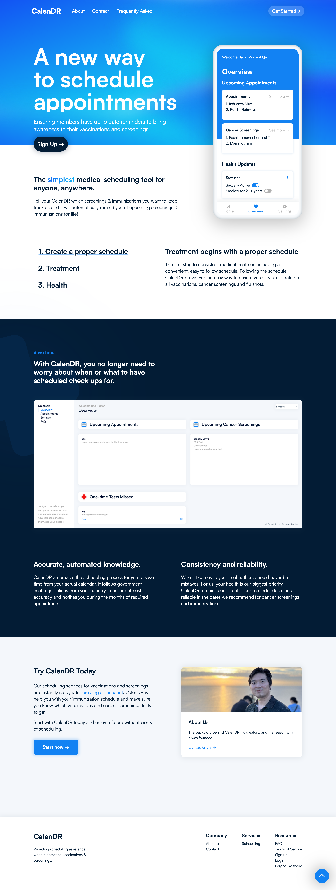

### About

### About — David
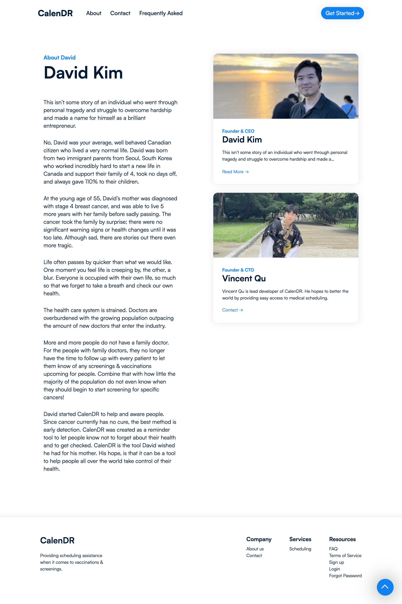

### Contact
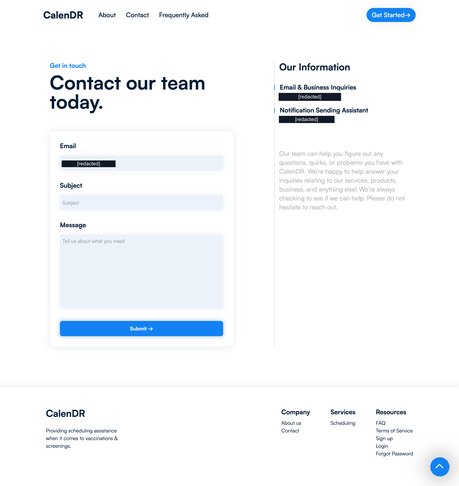

### FAQ

### Terms of Service

## Authentication

### Sign Up
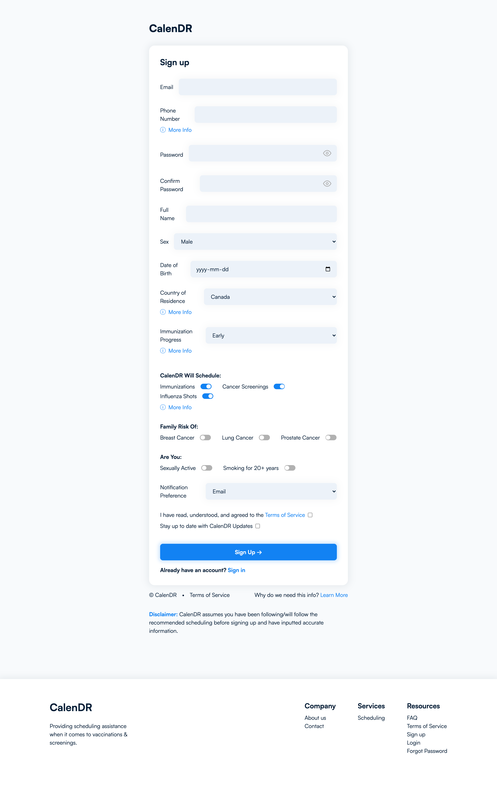

### Sign Up — error state
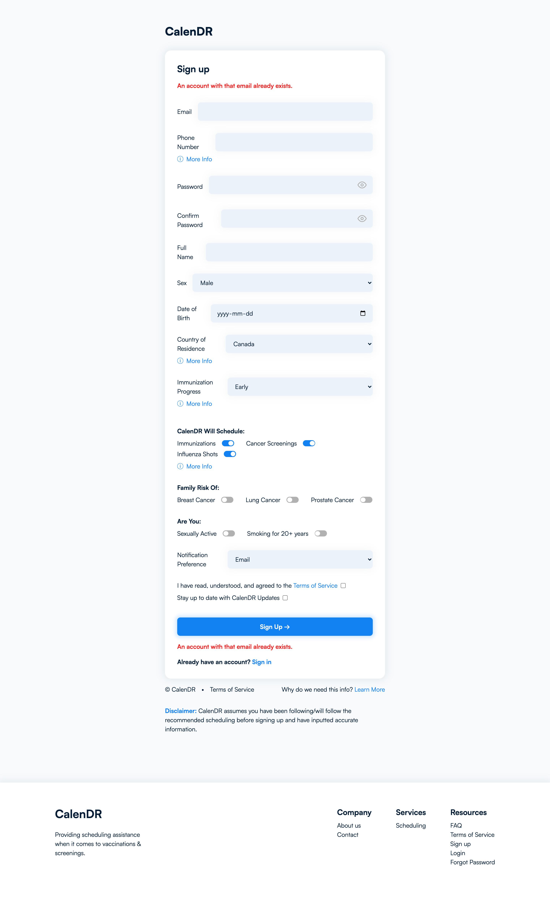

### Log In
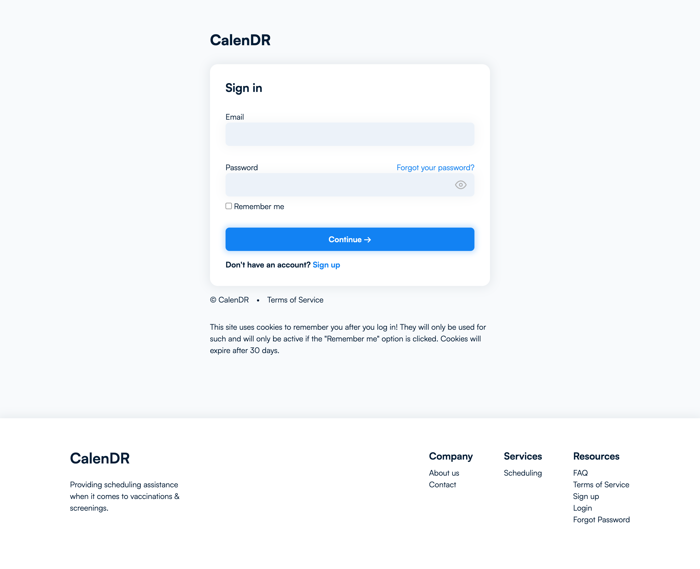

### Log In — error state
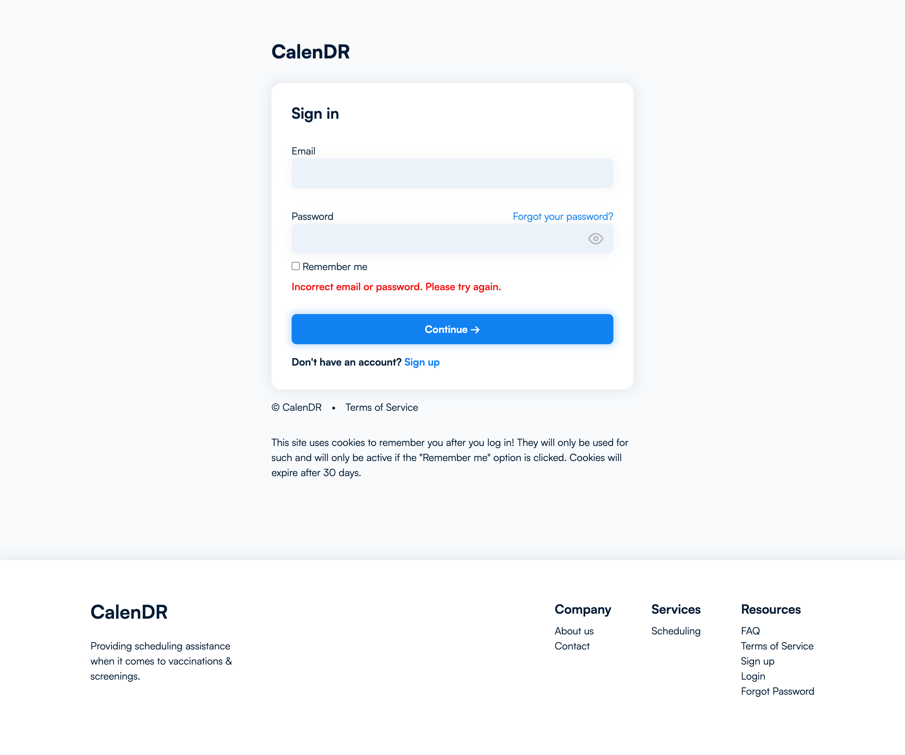

### Password Reset
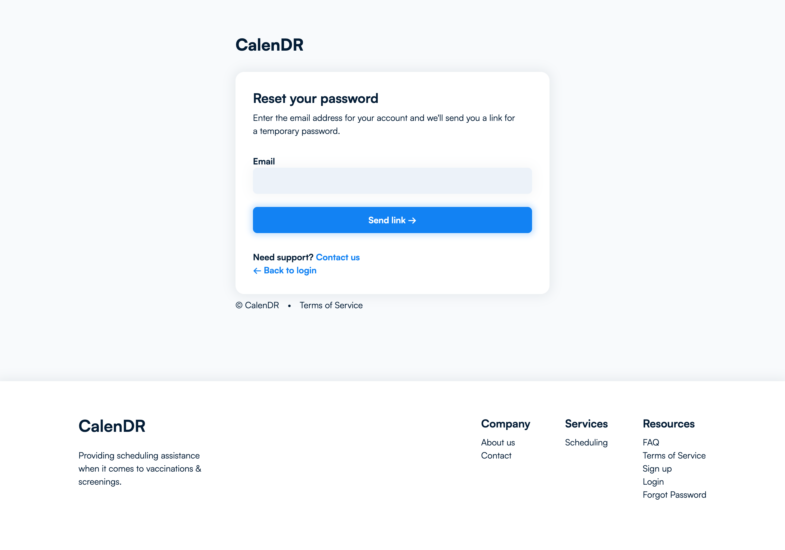

### Password Reset — error state
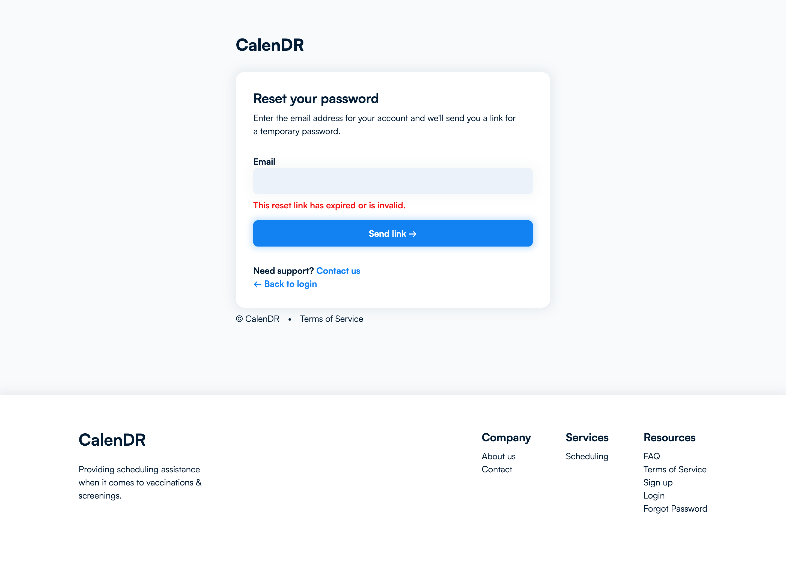

### Verification Sent
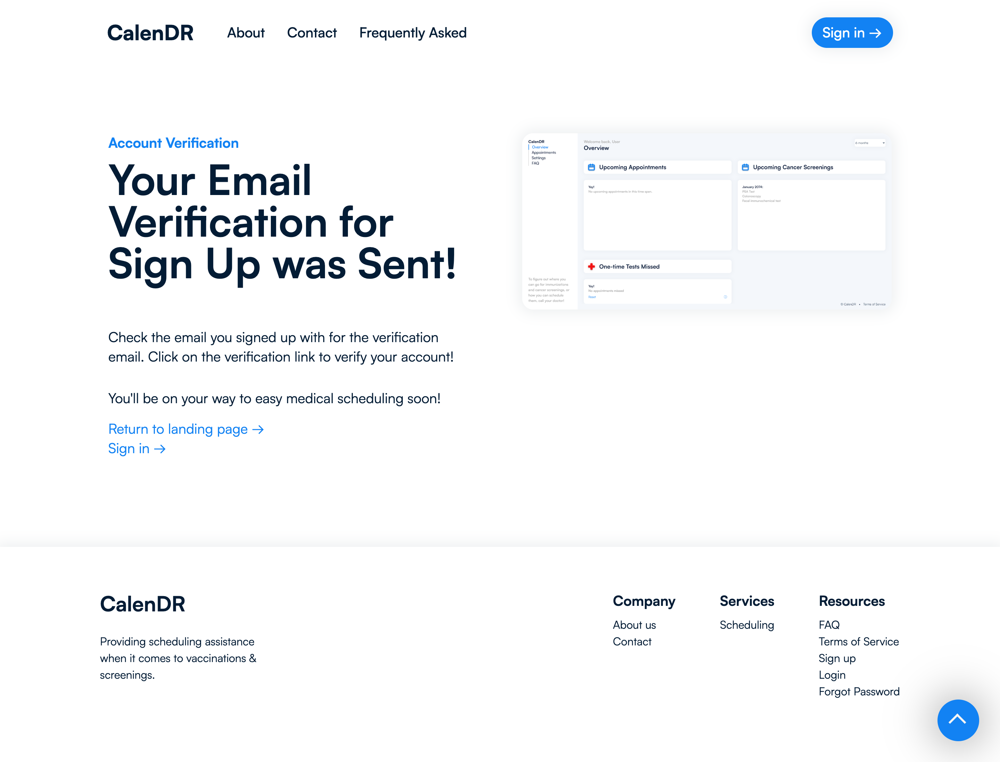

## Dashboard

### Overview
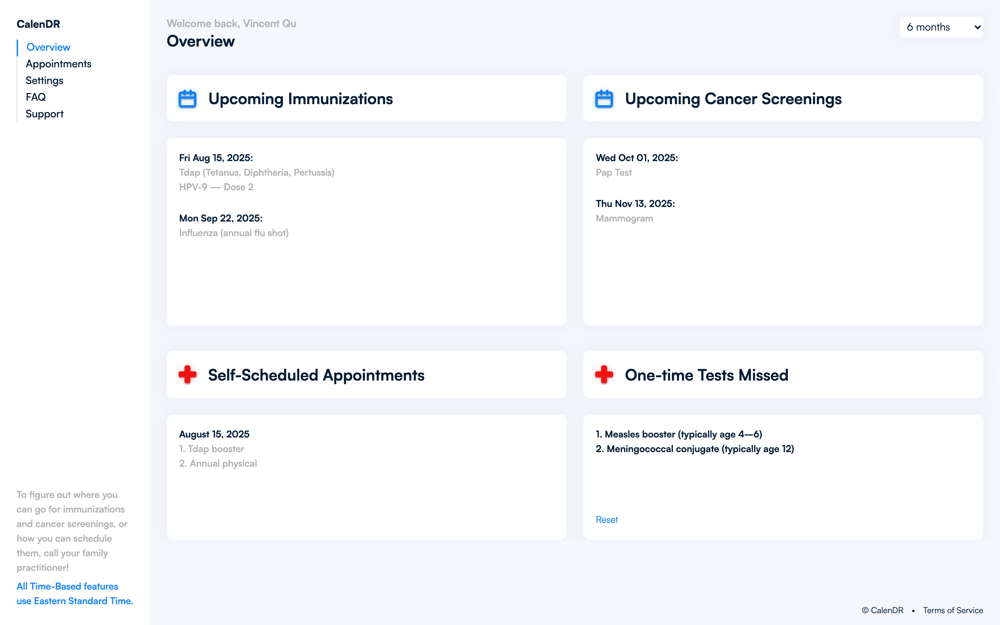

### Appointments
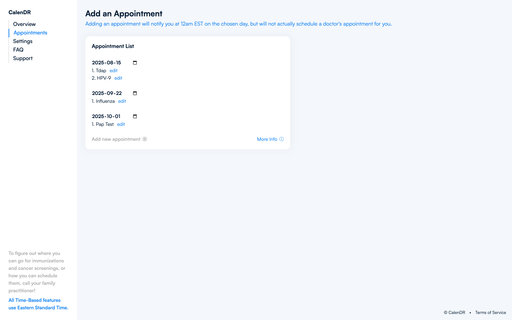

### Settings
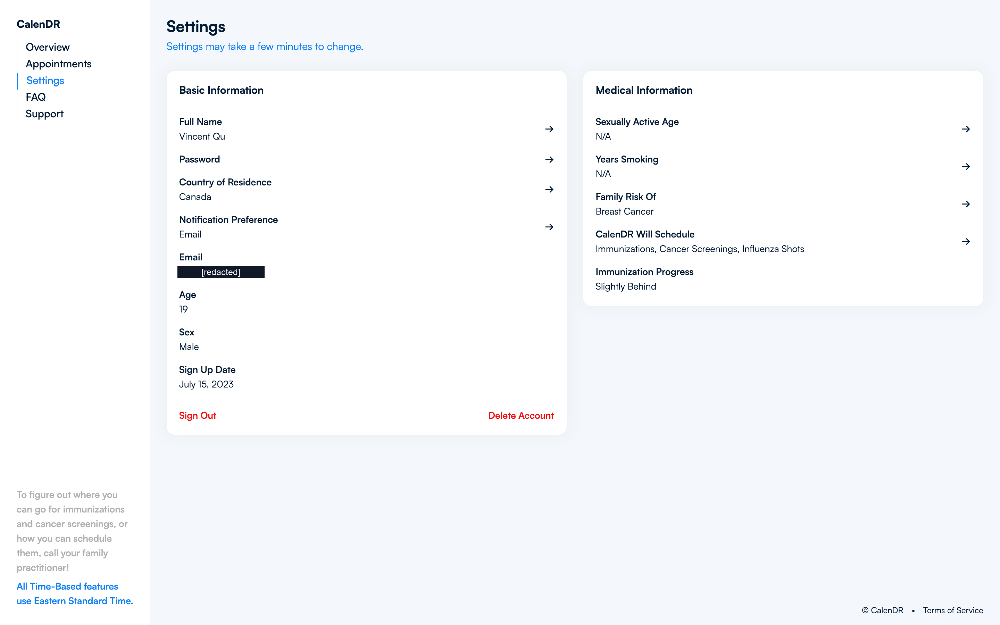

## Misc

### 404
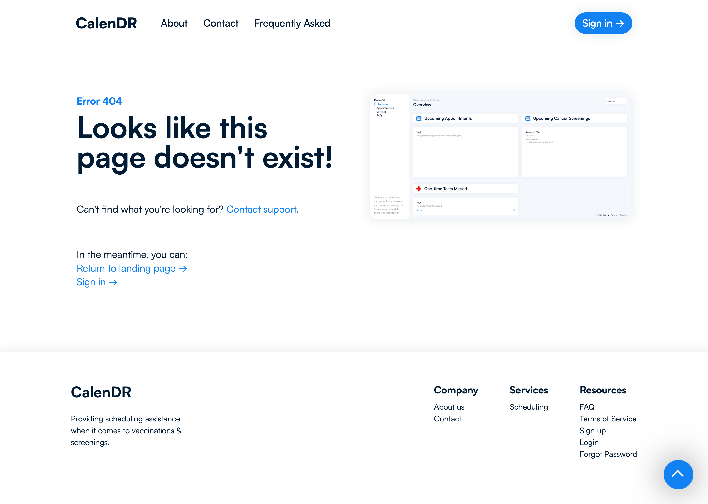

### Error
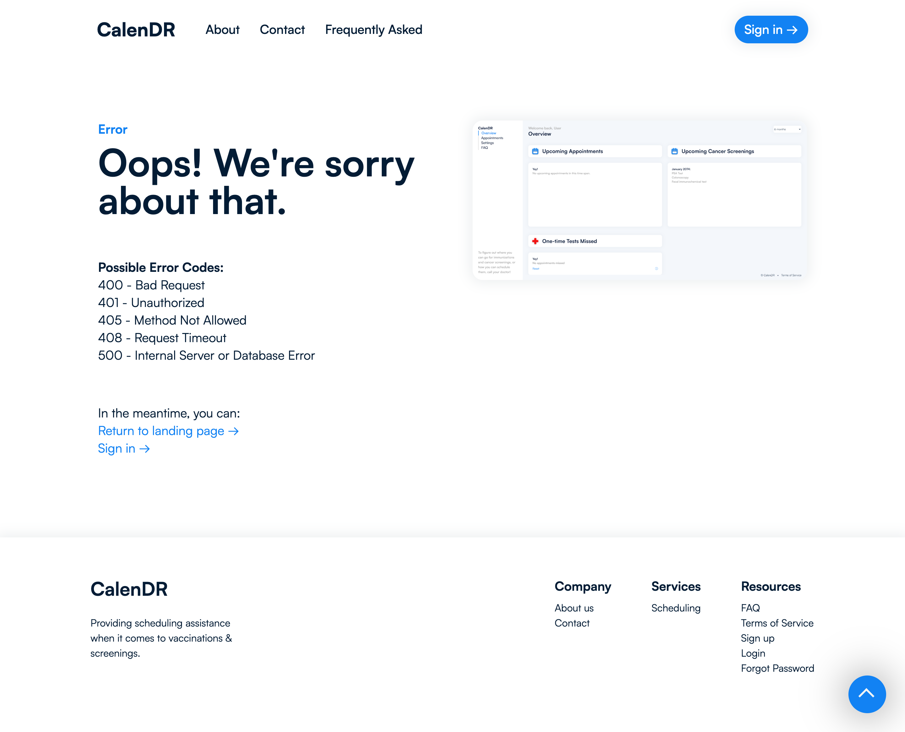
